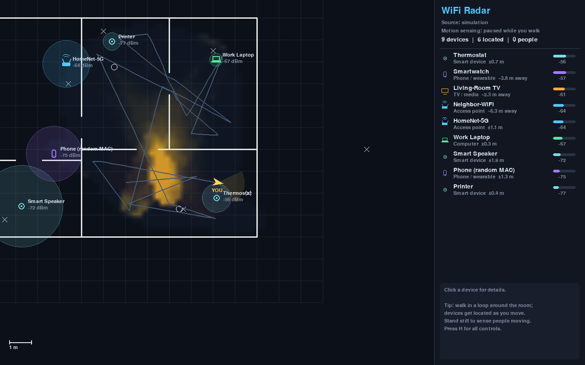
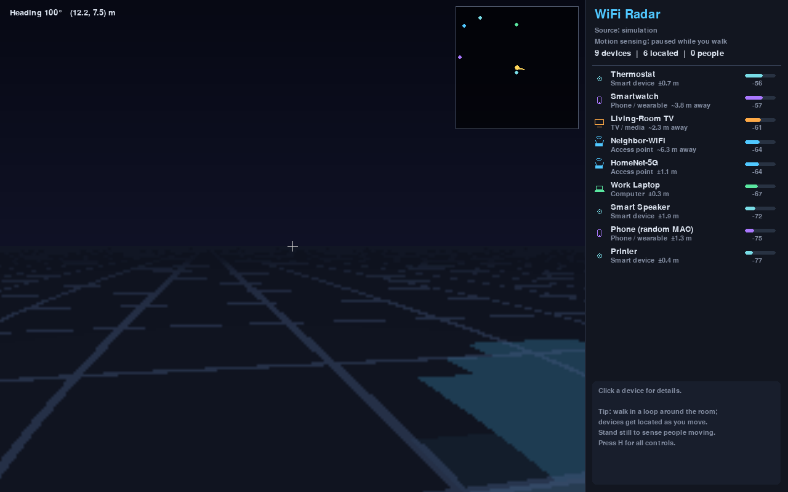

# WiFi Radar

Map the space around you using Wi-Fi signals. WiFi Radar listens to the
signal strength (RSSI) of every Wi-Fi device it can hear. As you walk around,
it works out:

* **where devices are**: routers, phones, laptops, TVs, smart-home gadgets
  (located by trilateration from the spots you measured them at)
* **where people are**: people show up as RF motion (a moving body makes the
  links it crosses flicker), and moving phones/watches usually mean someone
  is carrying them
* **what blocks signals**: walls and furniture appear as an obstacle map,
  built with radio tomography

All of this is drawn on a live map you can **walk around in**, from above
(Map view) or first-person (Explore view).




## Quick start

```bash
cd wifi_radar
pip install -r requirements.txt

# Try it with no special hardware: a simulated apartment with people walking around
python -m wifi_radar --sim

# Use your real Wi-Fi card (picks nmcli / netsh / macOS automatically)
python -m wifi_radar
```

## Controls

| Key | Action |
| --- | --- |
| WASD / arrows | walk (Map view: absolute directions; Explore view: forward/back, turn) |
| Q / E | turn (Map view) / strafe (Explore view) |
| Shift | walk faster |
| Tab | switch between Map view and Explore (first-person) view |
| Mouse wheel / right-drag | zoom / pan the map |
| Click | select a device for details and an RSSI graph |
| 1 / 2 / 3 | toggle obstacles / motion heat / labels |
| T / F | toggle your path / camera follow |
| G | show the simulation's ground truth (to see how accurate the map is) |
| P | autopilot (simulation) |
| Space | pause scanning |
| R | reset the map |
| Ctrl+S | save the map (devices, people, path) as JSON |
| H | help |

## How to use it with a real Wi-Fi card

You are the moving sensor, so the app has to know where you are. **Mirror
your real movement with the keys**: start in the middle of the room, and when
you take a step forward in real life, walk the avatar forward too. (1 m on
the map is the scale bar in the corner.)

1. Walk a slow loop around the room or flat. Devices become *located*
   (a marker with a ±uncertainty circle) once they have been measured from
   spots a metre or more apart. Until then the list shows only a rough
   distance.
2. Stand still for a few seconds to sense motion. The panel says
   "Motion sensing: ON" while you stand still. Movement then shows up as red
   heat, and as a person marker where two or more links agree.

### Backends

| Backend | Platform | Sees | Readings/s | Notes |
| --- | --- | --- | --- | --- |
| `nmcli` | Linux (NetworkManager) | access points | ~0.5 | no root, default on Linux |
| `iw` | Linux | access points | ~0.5 | real dBm values, needs root and `--iface wlan0` |
| `netsh` | Windows | access points | ~0.3 | default on Windows |
| `macos` | macOS | access points (by name) | ~0.2 | macOS hides BSSIDs |
| `monitor` | Linux + monitor-mode card | **everything**, including phones, laptops and IoT clients | many | `pip install scapy`, root |

Normal Wi-Fi cards can only list access points. To find **phones, laptops and
other client devices**, and to get readings fast enough for motion and people
sensing, use a USB Wi-Fi adapter that supports monitor mode:

```bash
sudo ip link set wlan1 down
sudo iw dev wlan1 set type monitor
sudo ip link set wlan1 up
sudo python -m wifi_radar --backend monitor --iface wlan1
```

Only sniff networks you own or have permission to monitor.

Tuning: `--exponent` sets the path-loss exponent (≈2 open space, 2.5–3.5 with
walls and furniture; default 2.4).

## How it works

| Module | What it does |
| --- | --- |
| `pathloss.py` | log-distance model `RSSI = P0 − 10·n·log10(d)` |
| `localization.py` | grid-search fit of each device's (x, y, P0) to all samples, then a posterior that gives the ± radius; coarse-to-fine for speed |
| `tracker.py` | the world model: samples, refits, mobility test (same spot, different RSSI later means the device moved), motion sensing, people tracks |
| `tomography.py` | radio tomographic imaging: excess loss and fluctuation are back-projected onto an ellipse around each link |
| `scanners.py` | OS scanners (`nmcli`, `iw`, `netsh`, `system_profiler`) and the scapy monitor-mode sniffer |
| `simulation.py` | a virtual flat with walls, devices and wandering people, for trying it out and testing |
| `ui.py` | pygame map, first-person view, device panel |

## Honest limitations

Wi-Fi RSSI is a noisy, rough signal. This is not a camera that sees through walls.

* Device positions are usually accurate to **1–2 m** (about 0.5–2 m in the
  simulation). Walls and reflections bias the results.
* With one receiver, people sensing is coarse. It needs you to stand still,
  works best with many devices around you, and reports people with roughly
  1–2 m error. Precise through-wall human imaging (as in research papers)
  uses CSI (channel state information) from special hardware, such as ESP32
  CSI firmware or Intel 5300 / Atheros cards, plus several receivers.
* OS scan backends update only every 2–5 s. That is fine for locating access
  points, but too slow for motion sensing (use `monitor` for that).
* You supply your own position with the keys; there is no indoor positioning
  of the receiver itself.

## Tests

```bash
pip install pytest
python -m pytest tests
```
